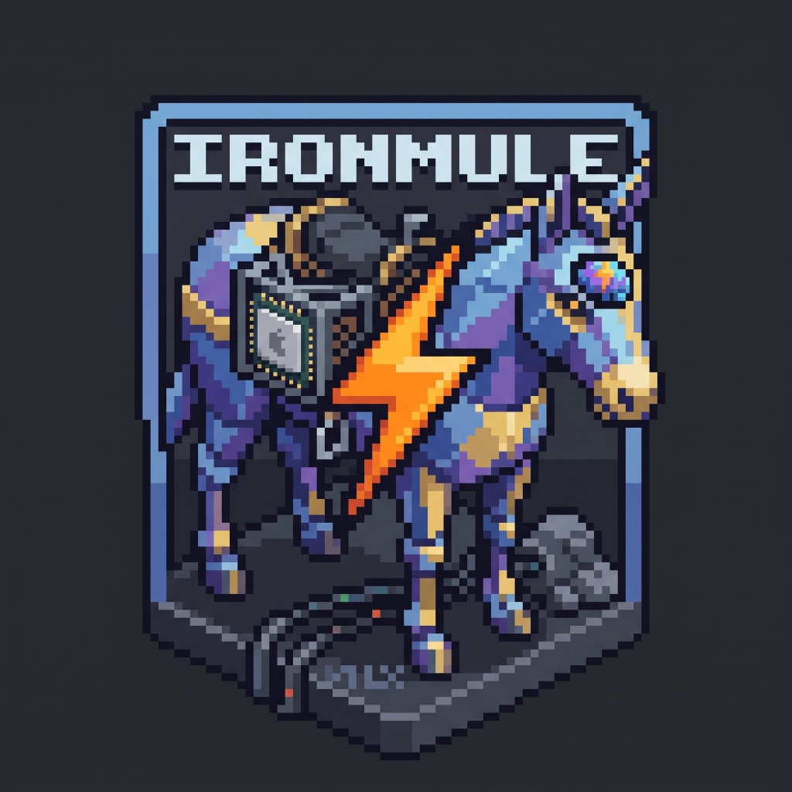

<div align="center">

  

  <a id="ironmule"></a>
  <h1>IronMule · Local LLM inference server</h1>

  <p><strong>Serve GGUF and MLX models through an OpenAI-compatible chat API. IronMule's own learned scheduler adapts inference to the hardware and the requests arriving on it.</strong></p>

  <p>
    <a href="https://github.com/Tobayko/IronMule/actions/workflows/ci.yml"></a>
    
    <a href="LICENSE.md"></a>
    
    
    
    
  </p>

</div>

[Quick start](#quick-start) · [Hardware support](#hardware-support) · [Benchmarks](#how-much-faster) · [How the Pilot learns](#the-pilot) · [HTTP API](docs/HTTP.md)

## What is IronMule?

IronMule is a self-hosted LLM server for local chat, streaming and concurrent requests. Its GGUF engine combines llama.cpp with IronMule's scheduler and kernels. The **Pilot** is a small neural network trained from scratch to make hardware decisions, including how many threads to use when another program starts competing for the CPU. The language model's weights stay fixed.

If you're looking for a **llama.cpp alternative** for serving GGUF on a shared CPU, start with the Xeon test below. IronMule produced **87.5 output tokens/s** across 32 simultaneous requests, compared with **28.9** for llama-server on the same Qwen3-4B file. If you're evaluating a **vLLM alternative** for a single NVIDIA GPU, the Tesla T4 results tell a different story. At 32 requests vLLM with AWQ produced **861 tokens/s** and IronMule with GGUF produced **627** in separate runs. Both use the Qwen3-4B model family with different four-bit formats. [Benchmark conditions and results](#how-much-faster)

## Quick start

### Serve a GGUF on Linux CPU

Use Python 3.10 or newer, a C/C++ toolchain, CMake, Git and `patch`. These commands set up a server from a checkout using Python 3.12. Have a GGUF with a chat template available locally.

```bash
git clone https://github.com/Tobayko/IronMule.git
cd IronMule
python3.12 -m venv .venv
source .venv/bin/activate
python -m pip install -e '.[cpu]'
ironmule setup --mode server
python tools/build_ggml.py
```

Run the two `export` commands printed by the build in this shell, then start the server with the path to your model. This example uses Qwen3-4B.

```bash
ironmule serve --gguf /path/to/Qwen3-4B-Q8_0.gguf --agent on
```

The first start measures the machine and checks the inference configuration. Open `http://127.0.0.1:8080` for the chat interface. From a second shell, list the available model and send a streaming chat request. The model ID consists of `gguf/` and the filename without its extension.

```bash
curl -sS http://127.0.0.1:8080/v1/models

curl -N http://127.0.0.1:8080/v1/chat/completions \
  -H 'Content-Type: application/json' \
  -d '{"model":"gguf/Qwen3-4B-Q8_0","messages":[{"role":"user","content":"What is continuous batching?"}],"stream":true}'
```

### Run an MLX model

On Apple Silicon or Linux with an NVIDIA GPU, install the CLI and start the local chat interface.

```bash
curl -fsSL https://raw.githubusercontent.com/Tobayko/IronMule/main/install.sh | sh
ironmule start
```

To choose and serve an MLX model explicitly, install from source with `python -m pip install -e .` on Apple Silicon or `python -m pip install -e '.[cuda]'` on supported NVIDIA hardware. Then register a model and serve it locally.

```bash
ironmule doctor
ironmule setup --mode server
ironmule models add mlx-community/gemma-3-1b-it-4bit --download
ironmule serve --model mlx-community/gemma-3-1b-it-4bit
```

See the HTTP documentation for supported OpenAI-compatible routes, authentication and TLS. [HTTP API](docs/HTTP.md)

## Hardware support

| Hardware | Execution path and evidence |
| --- | --- |
| Linux x86-64 CPU | GGUF through llama.cpp with IronMule scheduling and optional CPU kernels. Published tests include Intel Xeon and an AMD EPYC HTTP workload. MLX also offers a Linux CPU build. |
| NVIDIA GPU | GGUF via the CUDA build of llama.cpp, or MLX with its CUDA backend. HTTP comparisons include Tesla T4, NVIDIA L40S and GeForce RTX 4090. |
| Apple Silicon | MLX with Metal. Published results include the M1 Max. Current CI runs on Linux. |
| AMD Radeon GPU | Experimental ROCm/HIP build for GGUF. With the ROCm toolkit, `python tools/build_ggml.py --rocm` detects the architecture. To select a target explicitly, use e.g. `--rocm gfx1100`. After exporting the library paths, `ironmule doctor --ggml rocm` checks device execution. Radeon serving and throughput still need a hardware run. |
| Google TPU | Research probes measured matrix operations on a TPU v5e. An experimental JAX tool can calibrate a decode loop with synthetic weights. Full checkpoint inference through the HTTP server remains open. [TPU calibration](docs/TPU.md) |

Tested model families include Qwen 3, Gemma 3, Llama 3 and Mistral. Backend, model format, precision and hardware all matter when comparing results. [Runtime](docs/RUNTIME.md) · [Limits](docs/LIMITS.md) · [Hardware measurements](docs/BENCHMARKS.md)

## How much faster?

To compare on your own GPU, `ironmule compare` serves the same GGUF through IronMule,
stock llama-server and vLLM. It checks the input tokens, sends short and document
requests and measures output tokens/s, first-token latency and answer quality at each
concurrency. `ironmule compare-watch` repeats comparisons on a dedicated host within
a time allowance. The production controller chooses its own trials from local workload
measurements and tests each candidate against its own serving configuration. A CPU run
with SmolLM2 served 40 requests and selected an admission budget autonomously in an
isolated serving environment with the model and IronMule dependencies. Both settings solved 16/16 copy
tasks. One full output differed, so the worker kept its original setting.
[Self-directed trial](docs/LAB.md#2026-11-18-own-traffic-admission-learning-on-an-amd-epyc-cpu)
[Run the comparison](docs/COMPARE.md)

During inference, open `/live` on your IronMule server to see active and queued requests,
recent first-token times and controller decisions. The **Benchmarks** tab shows the
current engine, load and measured results. To watch a separate comparison file, run
`python -m ironmule_product.live_view --progress ./comparison.json --port 8787`
and open `http://127.0.0.1:8787/live#benchmarks`.


### CPU serving against llama.cpp and Ollama

The following results use the same 4-vCPU Intel Xeon, Qwen3-4B Q8_0 GGUF and questions through each server's HTTP API. The runs took place on November 13–14, 2026, once per engine. Aggregate throughput counts generated tokens across all clients. Time to first token measures the wait before a user starts seeing an answer.

| What happens | IronMule | llama.cpp server | Ollama | LM Studio |
| :-- | --: | --: | --: | --: |
| 32 people ask at once (tokens per second, all together) | **87.5** | 28.9 | 21.8 | -- |
| One person asks (tokens per second) | **10.1** | 8.0 | 8.6 | 6.1 |
| A question every 2 seconds: wait for the first word (median) | **0.33 s** | 113 s | 47 s | -- |
| 16 people in long conversations (tokens per second) | **47.8** | 13.0 | -- | -- |
| Fact check, 50 questions (right answers) | 49 | 49 | 49 | 49 |

IronMule, llama-server, Ollama and LM Studio each answered 49 of the 50 fact questions correctly. The burst comparison used 32 llama-server slots. At 8 and 16 clients, sizing llama-server to each burst produced 27.3 and 40.9 tok/s, compared with IronMule's 50.4 and 71.3. Ollama used 16 parallel slots after its 32-slot configuration ran out of memory. [Lab notes, CMP1](docs/LAB.md#2026-11-13-cmp1-ironmule-against-llamacpp-ollama-and-lm-studio-on-this-cpu-same-gguf)

A separate three-round test used Qwen3-0.6B Q4_K_M on two AMD EPYC virtual cores.
With four concurrent clients the medians were **4.95 vs 3.52 output tokens/s** for
IronMule and stock llama-server. IronMule had higher throughput in all six pairs,
but one pair regressed in first-token latency and one lost a previously correct
answer. It did not meet the comparison's overall acceptance criteria.
[Measured loads, latency and answer scores](docs/LAB.md#2026-11-18-qwen3-06b-on-two-epyc-vcpus-against-upstream-llama-server)

<details>
<summary>CPU performance when other programs compete for cores</summary>

| Busy foreign processes on the 4 cores | llama.cpp server, 1 user | IronMule, 1 user | llama.cpp server, 8 users | IronMule, 8 users |
| :-- | --: | --: | --: | --: |
| none | 7.23 tok/s | **9.33 tok/s** | 23.3 tok/s | **58.8 tok/s** |
| one | 0.24 tok/s | **7.07 tok/s** (29x) | 1.41 tok/s | **46.2 tok/s** (33x) |
| two | 0.13 tok/s | **5.46 tok/s** (42x) | 0.68 tok/s | **35.2 tok/s** (52x) |

With one competing process, time to first token was 23 s for llama-server at one client and 54 s at eight. IronMule measured 0.3 s. The original Pilot chose four, three and two threads at the three load levels. Greedy output was identical at four, three, two and one threads on the checked inputs. The tests used one run per configuration with collective speculation disabled. [Lab notes, PI1 and PI2](docs/LAB.md)

</details>

### Same-GGUF serving on NVIDIA L40S

With Qwen3-32B Q4_K_M and **32 concurrent requests** on a 48 GB L40S, IronMule
delivered **174.5 output tokens/s**, stock llama-server **130.4**, and vLLM 0.11.0
serving the identical GGUF **27.2**. Their median per-round p95 first-token times
were 3.96, 4.53 and 32.72 seconds. All three produced 162/162 correct short answers
across the three loads and three repetitions. IronMule met the predeclared acceptance
criteria against both reference servers in every measured pair.
[32B protocol, all loads and scored answers](docs/LAB.md#2026-11-18-qwen3-32b-on-nvidia-l40s-identical-gguf)

On the same L40S running Qwen3-0.6B Q4_K_M, IronMule served **929 output tokens/s**
at eight concurrent clients. Stock llama-server delivered **717** and vLLM 0.11.0
delivered **772**. At 32 clients vLLM led with **1,285**, followed by IronMule at
**1,248** and llama-server at **1,124**. These are medians of three repetitions with
identical tokenized requests. IronMule missed the overall latency and quality criteria.
[Full results and holdout scores](docs/LAB.md#2026-11-18-qwen3-06b-on-nvidia-l40s-against-llamacpp-and-vllm)

A second three-server run on an RTX 4090 found the same load-dependent result for Qwen3-0.6B. IronMule led at eight clients with 907 output tokens/s. At 32 clients vLLM led with 1,189 to IronMule’s 1,176. An earlier lab experiment used the measured first-token gap to trigger a scheduling trial. IronMule kept the incumbent after four held-out pairs. [RTX 4090 measurements and learning decision](docs/LAB.md#2026-11-18-qwen3-06b-on-geforce-rtx-4090)

### Single-GPU inference against vLLM

A separate matched deployment test on a 48 GB L40S used Qwen3-32B Q4_K_M in IronMule
and the official Qwen3-32B-AWQ checkpoint in vLLM 0.11.0, which selected AWQMarlin.
With one client, median output throughput was **37.9 vs 32.9 tok/s**. At eight clients
it was **107.4 vs 143.2**, and at 32 clients **165.0 vs 225.1**. Both servers solved
162/162 short holdouts. vLLM's median p95 time to first visible token was lower at
each load. All nine paired rounds matched on input tokens, output lengths and stop
reasons. [Full deployment comparison](docs/LAB.md#2026-11-18-qwen3-32b-gguf-and-native-awq-on-one-l40s)

On one Tesla T4, the IronMule KG4 engine and vLLM served Qwen3-4B. The table reports aggregate output tokens per second. IronMule used Q4_K_M GGUF, and vLLM used the AWQ model. The values come from separate benchmark sessions on this GPU type. A matched run through both current HTTP servers would be needed for a new end-to-end comparison.

| Concurrent requests | IronMule GGUF (KG4) | vLLM AWQ (MG2 v6) |
| ---: | ---: | ---: |
| 1 | 56.3 | 63.7 |
| 8 | 310.4 | 419.2 |
| 32 | 626.9 | 860.5 |

At eight clients the generated CUDA kernels raised IronMule's own throughput from 249.2 to 310.4 tok/s. At 32 clients the change was smaller, from 602.2 to 626.9. Both versions answered 49 of 50 fact questions correctly. vLLM led at all three concurrency levels. [IronMule KG4 results](docs/LAB.md#2026-11-17-kg4-where-a-gpu-step-of-8-32-requests-goes-and-a-q4_k-tensor-core-kernel-for-1-32-tokens) · [vLLM MG2 v6 results](docs/LAB.md#2026-11-15-mg2-v6-the-shared-pools-padded-answers-on-a-gpu)

An experimental T4 kernel targets grouped-query attention at 32 concurrent streams and 1,024 KV rows. Its benchmark first checks the CUDA calculation, then requires at least a 10% shorter decode step before testing the HTTP server, factual answers and first-token latency. A speedup from this kernel has yet to be measured on a T4. [KG5 benchmark](lab/kg5/README.md)

<details>
<summary>GGUF results across four model families on one and two Tesla T4 GPUs</summary>

This earlier comparison used identical Q4_K_M GGUF files in each engine and 128 tokens per answer. MG2 v5 ran three blocks per configuration, and v6 repeated the measurements within a few percent. The IronMule configuration used a shared KV pool and padded decode batches.

| | Qwen3-4B | Gemma 3 4B | Mistral 7B | Llama 3.1 8B |
| :-- | --: | --: | --: | --: |
| 8 requests: best llama.cpp server setup (some use both GPUs) | 193.5 | 195.2 | 128.0 | 119.1 |
| 8 requests, one GPU: IronMule | **270.7** | **263.6** | **175.1** | **157.7** |
| 32 requests, one engine per GPU: llama.cpp server | 786.0 | 713.2 | 614.1 | 544.1 |
| 32 requests, one engine per GPU: IronMule | **1026.9** | **1007.3** | **679.1** | **633.2** |

Every engine comparison above is in aggregate tok/s. Each model answered the same 47 to 49 facts correctly as llama.cpp in its corresponding run. An additional HTTP test on Qwen3 changed the GPU KV layout from a shared pool to a stream per request. With 32 clients throughput rose from 422 to 518 tok/s. At eight clients it fell from 260 to 238. [Lab notes, MG2 and KG3](docs/LAB.md)

</details>

<details>
<summary>Apple Silicon and NVIDIA GPUs (MLX path)</summary>

On MLX, IronMule's exact mode returns the same tokens as stock MLX, checked token by token before use:

| Model (4-bit) | Apple M1 Max | NVIDIA Tesla T4 | T4, opt-in `--compute-dtype float32` |
| :-- | --: | --: | --: |
| Gemma 3 1B | **1.61× · +61%** | **1.82× · +82%** | — |
| Gemma 3 4B | **1.27× · +27%** | 1.05× · +5% | **1.91× · +91%** |
| Gemma 3 12B | **1.11× · +11%** | 1.03× · +3% | **2.04× · +104%** |

Each device is compared with stock MLX on that device. The float32 column uses different arithmetic and requires a quality check. Results for six more model families, native kernels and server batching are in
[docs/BENCHMARKS.md](docs/BENCHMARKS.md).

</details>

## The Pilot

IronMule trains its own inference scheduler. The Pilot reads 20 features, including available CPU cores, competing load, measured step costs, active and waiting requests, prompt lengths and recent step times. Two hidden layers of 128 units and four output heads select the thread count, batch cap, prompt budget and use of a draft model. A decision took approximately 0.17–0.19 ms inside the measured Xeon server and 0.11 ms beside a T4.

The published CPU and GPU versions began with random weights, learned from a short teacher warm-up, and trained with reinforcement learning (PPO) on simulated servers. These “dreams” replay workloads against measured hardware costs. For the shipped CPU Pilot, two T4s simulated 8,192 servers at once during a 47-minute training run. The trained weights and inference code are public. The full training simulator and recipe are private. [CPU weights](ironmule/pilot_weights.npz) · [GPU weights](ironmule/pilot_weights_gpu.npz) · [Pilot implementation](ironmule/pilot.py)

**Learning on the serving machine.** Start a Linux CPU server with `ironmule serve --gguf MODEL.gguf --agent on`. During idle periods the agent can replay recent traffic. A local cost model starts at zero, learns from faster runs, slower runs and token mismatches, and adds weights as it encounters new hardware and workload features. It ranks thread counts to test for one to four concurrent requests. Before a new setting can serve, repeated trials on the same machine must reproduce the tokens and improve decode time. After a restart, the agent checks the setting again when matching traffic returns. Set `IRONMULE_PILOT_LEARN=0` to disable local thread learning. [Operating guide](docs/AGENT.md) · [Two-request CPU experiment](docs/LAB.md#2026-11-18--from-scratch-hardware-model-two-concurrent-decodes)

**What happened when the traffic changed?** On a four-vCPU AMD EPYC, 16 clients switched from short chats to long documents and back. The agent predicted that widening the batch from 8 to 64 slots would help. Live throughput fell, and the updated controller reverted after 16 completions. It kept the recovered setting through all three returning chat waves. Those chats reached 50.77 output tok/s with the agent and 78.68 with the fixed setting. Each arm answered 138 of 144 factual requests correctly. This was one run per arm. [Workload, timings and earlier attempts](docs/LAB.md#2026-11-18--earlier-ag10-withdrawal-and-recovery-after-a-failed-live-switch)

## Where the speed comes from

- **Continuous batching** lets arriving requests join a decode batch while earlier requests are still generating.
- **KV cache reuse** shares work on common prefixes. Per-request KV streams can reduce GPU attention work when many independent chats are active.
- **Hardware-specific kernels** include AVX-512 and Intel AMX CPU paths, plus generated CUDA kernels for quantized GGUF matrix multiplication. IronMule times candidates on the target device.
- **Speculative decoding** lets a smaller model propose tokens for the target model to verify. On a T4, adding a draft model raised single-client Qwen3-4B throughput from 44.1 to 54.1 tok/s in the DM2 test.

See `GET /health` for the active engine and Pilot status. [Engine and Pilot](docs/AGENT.md) · [Experiments](docs/LAB.md)

## Can I trust the numbers?

To reproduce a comparison, record the model and quantization, hardware, concurrency, prompt and output lengths, and whether the measurement covers a kernel, a decode step or a complete HTTP request. Use the same request trace for both servers. Check throughput alongside time to first token and answer quality. The lab directory includes the HTTP comparison harnesses. The MLX benchmark tests also check published figures against committed evidence. [HTTP comparison harness](lab/cmp/bench.py) · [Benchmark methodology and results](docs/BENCHMARKS.md) · [Evidence](evidence/)

```bash
python -m pip install -e '.[dev,figures]'
python -m pytest tests/claims
```

## What is in this repository

| Folder | What it is |
| :-- | :-- |
| `ironmule/` | The runtime: the ggml engine and the Pilot, MLX generation, cache, plans, kernels |
| `ironmule_product/` | The server, chat page, the agent, calibration and worker processes |
| `native/` | IronMule's llama.cpp kernel patches and the Rust learning core |
| `lab/` | Experiments and the comparison harness behind the numbers above ([docs/LAB.md](docs/LAB.md)) |
| `evidence/`, `friday_evidence/` | Redacted results and their provenance |
| `training/` | Simulation and measurement of the agent ([how](training/README.md)) |
| `tests/` | Runtime, server, agent, learning, evidence and published-number tests |
| `docs/` | User documentation, index in [docs/README.md](docs/README.md) |
| `tools/` | Build, figure and evidence tools |

## Learn more

- **[The agent and the Pilot](docs/AGENT.md)** — how they decide and learn.
- **[Benchmarks](docs/BENCHMARKS.md)** · **[Lab notes](docs/LAB.md)** — every number, with its setup.
- **[HTTP API](docs/HTTP.md)** · **[Runtime](docs/RUNTIME.md)** · **[Limits](docs/LIMITS.md)** (rejected ideas: [docs/BACKLOG.md](docs/BACKLOG.md))
- **[Documentation index](docs/README.md)** · **[Research lab](https://github.com/Tobayko/IronMule-Research)**
- **[Contributing](CONTRIBUTING.md)** · [code of conduct](CODE_OF_CONDUCT.md) · [security policy](SECURITY.md)
- **[License](LICENSE.md)** — Apache 2.0. Website: [ironmule.prometo.app](https://ironmule.prometo.app/).
