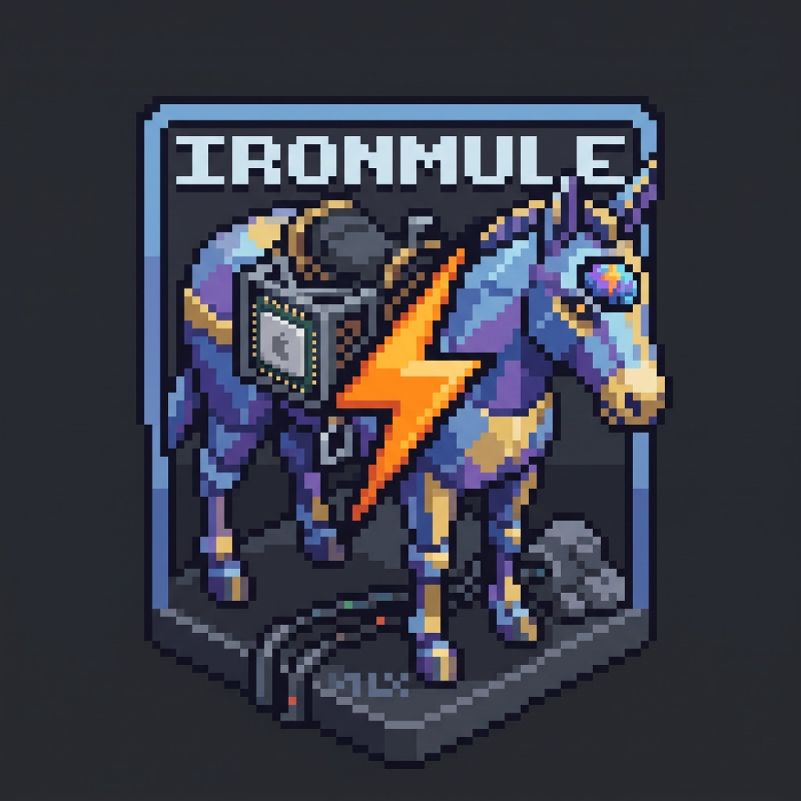

<div align="center">

  

  <h1>IronMule</h1>

  <p><strong>An AI chat server for the computer you already have, steered by a small trained AI of its own.<br>
  Up to 3x the tokens per second of llama.cpp and Ollama on the same CPU and model, and still fast when the machine is busy.</strong></p>

  <p>
    <a href="https://github.com/Tobayko/IronMule/actions/workflows/ci.yml"></a>
    
    <a href="LICENSE.md"></a>
    
    
    
    
  </p>

  <p>
    <a href="#quick-start"><strong>Quick start</strong></a> ·
    <a href="#the-pilot"><strong>The Pilot</strong></a> ·
    <a href="#how-much-faster"><strong>Numbers</strong></a> ·
    <a href="docs/BENCHMARKS.md"><strong>All benchmarks</strong></a> ·
    <a href="docs/HTTP.md"><strong>HTTP API</strong></a> ·
    <a href="docs/LIMITS.md"><strong>Limits</strong></a>
  </p>

</div>

---

## What is IronMule?

**Imagine a kitchen.** The language model is the cook. Many guests order at once, and the kitchen has only so many
hands, stoves and fridges. A good head waiter decides who gets served next, how many plates go out together, and how
many helpers are in the kitchen right now, so nobody waits long. If somebody else is using half the kitchen, the
waiter notices and plans around it.

**IronMule is that kitchen, and its head waiter is the Pilot**: a small neural network (about 22,000 numbers) that
looks at your machine and the people asking, and decides again before every step of the language model how that step
runs, in about half a millisecond. It never changes what the model answers. It only decides how the work is done.

For developers: IronMule is a local, OpenAI-compatible LLM server. It serves GGUF models through llama.cpp's kernels
plus its own (continuous batching, a shared prefix cache, AVX-512 and AMX attention kernels, a draft model) and MLX
models on Apple Silicon and NVIDIA GPUs. Qwen 3, Gemma 3, Llama 3 and Mistral run on it. Everything stays on your
machine.

## How much faster?

**Same 4-vCPU Intel Xeon, same model (Qwen3-4B Q8_0), same questions, one run per engine (2026-11-13/14):**

| What happens | IronMule | llama.cpp server | Ollama | LM Studio |
| :-- | --: | --: | --: | --: |
| 32 people ask at once (tokens per second, all together) | **87.5** | 28.9 | 21.8 | -- |
| One person asks (tokens per second) | **10.1** | 8.0 | 8.6 | 6.1 |
| A question every 2 seconds: wait for the first word (median) | **0.33 s** | 113 s | 47 s | -- |
| 16 people in long conversations (tokens per second) | **47.8** | 13.0 | -- | -- |
| Fact check, 50 questions (right answers) | 49 | 49 | 49 | 49 |

Ollama ran with 16 parallel slots (its 32-slot setting ran out of memory on this machine; with its default it made
7.8 tokens per second). Every engine got the same answers right: the speed costs no quality.

**A busy server.** Real servers are rarely alone: a backup, a build or another program keeps some cores busy.
llama.cpp-based servers then use every core anyway, and their threads keep waiting for the one that was pushed
aside. The Pilot sees the foreign load and gives up exactly those cores:

| Busy foreign processes on the 4 cores | llama.cpp server, 1 user | IronMule, 1 user | llama.cpp server, 8 users | IronMule, 8 users |
| :-- | --: | --: | --: | --: |
| none | 7.23 tok/s | **9.33 tok/s** | 23.3 tok/s | **58.8 tok/s** |
| one | 0.24 tok/s | **7.07 tok/s** (29x) | 1.41 tok/s | **46.2 tok/s** (33x) |
| two | 0.13 tok/s | **5.46 tok/s** (42x) | 0.68 tok/s | **35.2 tok/s** (52x) |

With one busy program the llama.cpp server took 23 s to the first word for one user and 54 s for eight; IronMule
took 0.3 s. The Pilot chose 4, 3 and 2 threads, and the answers are token for token the same at every thread count
(checked at 4, 3, 2 and 1 threads). Same machine and model, through each server's HTTP API, one run each; IronMule's
collective speculation (SP4) was off so that only the Pilot made the difference ([docs/LAB.md](docs/LAB.md), PI1).

<details>
<summary>Apple Silicon and NVIDIA GPUs (MLX path)</summary>

On MLX, IronMule's exact mode returns the same tokens as stock MLX, checked token by token before use:

| Model (4-bit) | Apple M1 Max | NVIDIA Tesla T4 | T4, opt-in `--compute-dtype float32` |
| :-- | --: | --: | --: |
| Gemma 3 1B | **1.61× · +61%** | **1.82× · +82%** | — |
| Gemma 3 4B | **1.27× · +27%** | 1.05× · +5% | **1.91× · +91%** |
| Gemma 3 12B | **1.11× · +11%** | 1.03× · +3% | **2.04× · +104%** |

Each device against its own stock MLX reference. The float32 column changes the arithmetic, must pass a perplexity
gate, and is never switched on by itself. Six more model families, native kernels and server batching:
[docs/BENCHMARKS.md](docs/BENCHMARKS.md).

</details>

## The Pilot

The Pilot is IronMule's decision model, trained from scratch for this one job. On every engine step it reads
20 numbers: how many cores this server may use and how many of them other programs keep busy, what a step costs on
this machine (measured at startup), how many requests run and wait, how long their prompts and contexts are, and how
the last step went. It then picks four things for the next step:

1. **how many CPU threads** the step uses,
2. **how many requests** run together,
3. **how many prompt tokens** may join a step (new guests against those already eating),
4. **whether the draft model** may guess ahead.

| | |
| :-- | :-- |
| Size | 20 inputs, two layers of 128, four output heads: about 22,000 weights (88 KB) |
| Decision time | about 0.5 ms per step in the running server: the network itself takes about 20 microseconds, the rest is reading the CPU load from `/proc` on the 4-vCPU Xeon, including reading the CPU load |
| Training | from scratch, by reinforcement learning in a dreamed world built from measured costs, with randomised machines, models, traffic and foreign load |
| In the dream | 240 s of dreamed serving on 1,024 random machines: 10.9 % more tokens than the engine's defaults and 38 % less waiting, about as good as the best hand rule (1 % behind it on reward), which it imitated first and then refined |
| On the real machine | threads follow the load: 4, 3 and 2 with no, one and two busy foreign processes; on an idle machine as fast as the defaults (9.81 against 9.81 tokens per second, same engine, alternating) |
| Answers | unchanged: every decision is a scheduling or threading choice |
| Safety | without weights, with inputs outside what it was trained on, or with `IRONMULE_PILOT=0`, the engine keeps its own defaults |

The weights are open ([ironmule/pilot_weights.npz](ironmule/pilot_weights.npz)), and so is the code that runs them
([ironmule/pilot.py](ironmule/pilot.py)). The training world and recipe are not published. `GET /health` shows under
`ggml.pilot` what it decided, the foreign load it saw and how long its decisions took.

Beyond the Pilot, the IronMule agent (`--agent on`) picks the engine configuration itself and only serves what it
measured faster on your machine; see [docs/AGENT.md](docs/AGENT.md).

## Quick start

On a Linux machine with only a CPU, serve a GGUF with the Pilot:

```bash
git clone https://github.com/Tobayko/IronMule.git
cd IronMule
python -m venv .venv && source .venv/bin/activate
pip install -e ".[cpu]"
python tools/build_ggml.py
```

`build_ggml.py` builds llama.cpp with IronMule's kernels and prints two `export` lines; run them. Then register a
model with the same tokenizer as your GGUF (it gives the chat template) and serve the GGUF behind it:

```bash
ironmule models add Qwen/Qwen3-1.7B --download
ironmule serve --gguf Qwen3-4B-Q8_0.gguf --model Qwen/Qwen3-1.7B --agent on
```

On the first start IronMule checks the GGUF's quality on this machine and measures its step costs for the Pilot.

The server listens on `http://127.0.0.1:8080`. Open it in a browser, or call its chat API:

```bash
curl http://127.0.0.1:8080/v1/chat/completions \
  -H "Content-Type: application/json" \
  -d '{"model": "Qwen/Qwen3-1.7B", "messages": [{"role": "user", "content": "Hello!"}]}'
```

On an Apple Silicon Mac or with an NVIDIA GPU (MLX path), one line installs and starts a chat:

```bash
curl -fsSL https://raw.githubusercontent.com/Tobayko/IronMule/main/install.sh | sh
ironmule start
```

From source there: `pip install -e .` (Mac) or `pip install -e ".[cuda]"` (NVIDIA), then
`ironmule doctor`, `ironmule models add mlx-community/gemma-3-1b-it-4bit --download` and
`ironmule serve --model mlx-community/gemma-3-1b-it-4bit`. Add `"stream": true` for streamed tokens; routes, auth and
TLS are in [docs/HTTP.md](docs/HTTP.md). From Python:

```python
import ironmule

runtime = ironmule.Runtime.load(model_id="mlx-community/gemma-3-4b-it-4bit")
print(runtime.generate("Explain unified memory in two short sentences.", max_tokens=96).text)
```

## Where the speed comes from

- **Many guests, one pot.** Requests that run together share each step (continuous batching), so 32 people cost
  little more than a few.
- **Shared beginnings.** When requests start with the same system prompt or conversation, it is computed once and
  shared from one memory pool (SP1).
- **Own attention kernels.** AVX-512 and Intel AMX flash attention (FA1, FA1x): a decode step at 16 x 1,024 tokens
  2.69x faster than llama.cpp's own.
- **A small model that guesses ahead.** With one or two users a draft model proposes tokens the big model checks in
  one step (DM1): 13.7 to 22.2 tokens per second for one user.
- **The Pilot**, so all of this keeps working when the machine is shared.

Every path that could change an answer must pass a quality gate first (perplexity within 0.5 % of llama.cpp's
default, and a fact check against a reference engine), and `/health` names the path that serves.

## Can I trust the numbers?

- **Measured, not guessed.** Each number names its machine, model and comparison; one run per engine unless stated.
  Details, setups and caveats: [docs/LAB.md](docs/LAB.md) (CMP1, PI1, FA1, DM1) and
  [docs/BENCHMARKS.md](docs/BENCHMARKS.md).
- **Correct before fast.** A path that gets facts wrong is out, whatever its speed.
- **Check it yourself.** The MLX numbers live in [`evidence/`](evidence/) and tests pin the published numbers to them:

```bash
pip install -e ".[dev,figures]"
python -m pytest tests/claims               # every published number matches its evidence
ironmule benchmark                          # measure your own machine
```

## What is in this repository

| Folder | What it is |
| :-- | :-- |
| `ironmule/` | The runtime: the ggml engine and the Pilot, MLX generation, cache, plans, kernels |
| `ironmule_product/` | The server, chat page, the agent, calibration and worker processes |
| `native/` | IronMule's llama.cpp kernel patches and the Rust learning core |
| `lab/` | Experiments and the comparison harness behind the numbers above ([docs/LAB.md](docs/LAB.md)) |
| `evidence/`, `friday_evidence/` | Redacted results and their provenance |
| `training/` | Simulation and measurement of the agent ([how](training/README.md)) |
| `tests/` | Runtime, server, agent, learning, evidence and published-number tests |
| `docs/` | User documentation, index in [docs/README.md](docs/README.md) |
| `tools/` | Build, figure and evidence tools |

## Learn more

- **[The agent and the Pilot](docs/AGENT.md)** — how they decide and learn.
- **[Benchmarks](docs/BENCHMARKS.md)** · **[Lab notes](docs/LAB.md)** — every number, with its setup.
- **[HTTP API](docs/HTTP.md)** · **[Runtime](docs/RUNTIME.md)** · **[Limits](docs/LIMITS.md)** (rejected ideas: [docs/BACKLOG.md](docs/BACKLOG.md))
- **[Documentation index](docs/README.md)** · **[Research lab](https://github.com/Tobayko/IronMule-Research)**
- **[Contributing](CONTRIBUTING.md)** · [code of conduct](CODE_OF_CONDUCT.md) · [security policy](SECURITY.md)
- **[License](LICENSE.md)** — Apache 2.0. Website: [ironmule.prometo.app](https://ironmule.prometo.app/).
